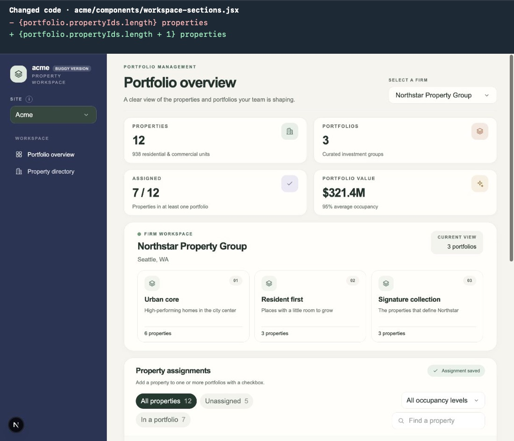
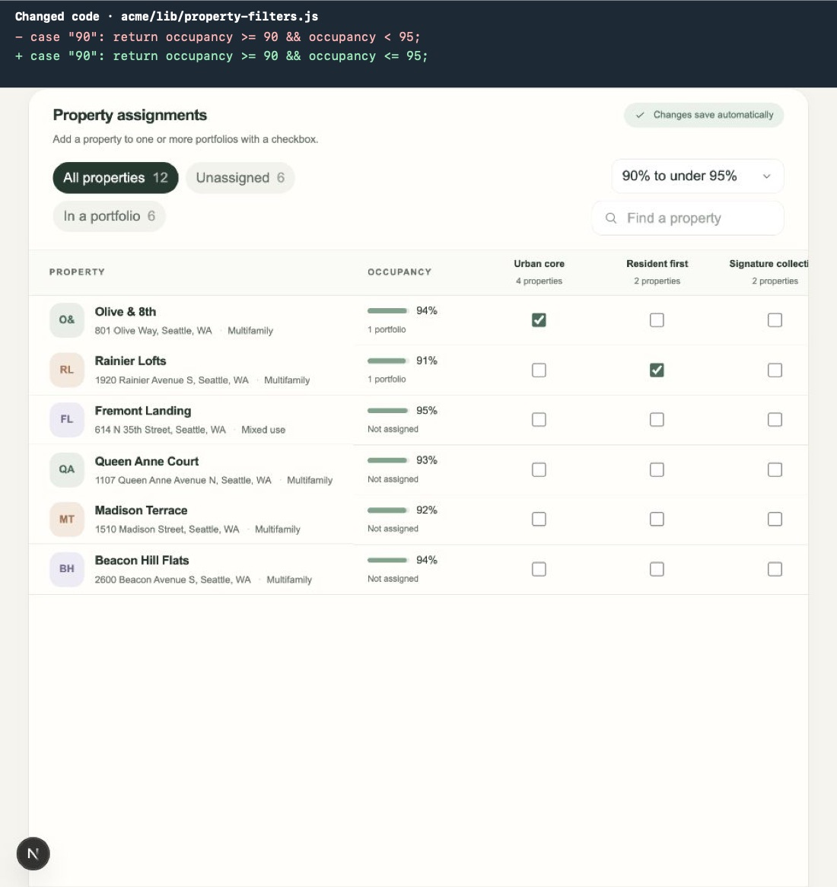
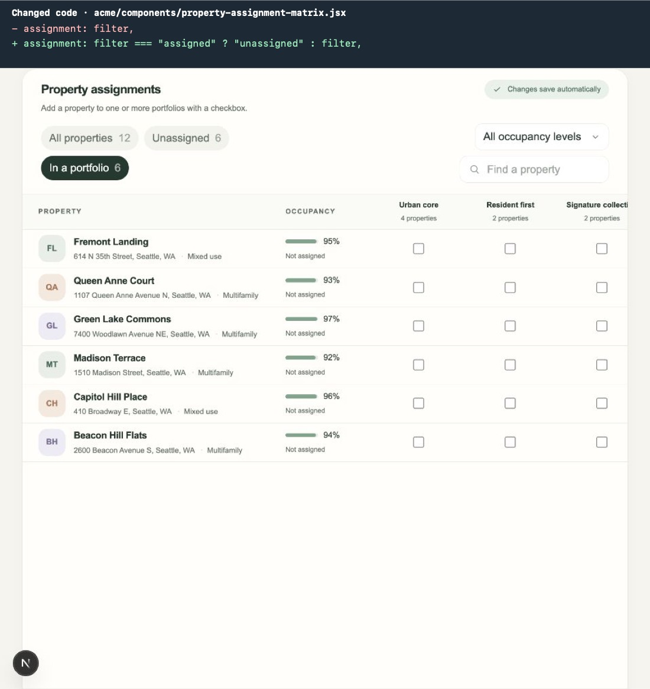
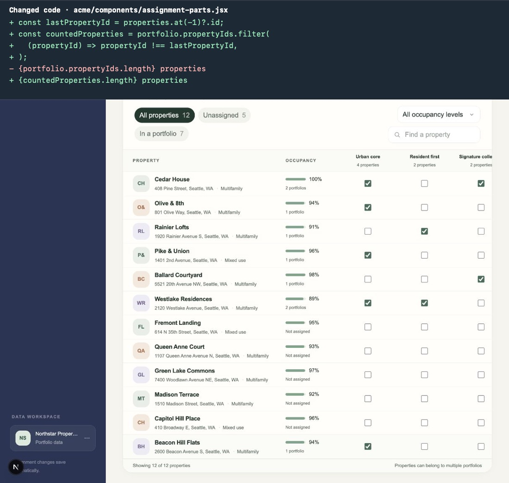
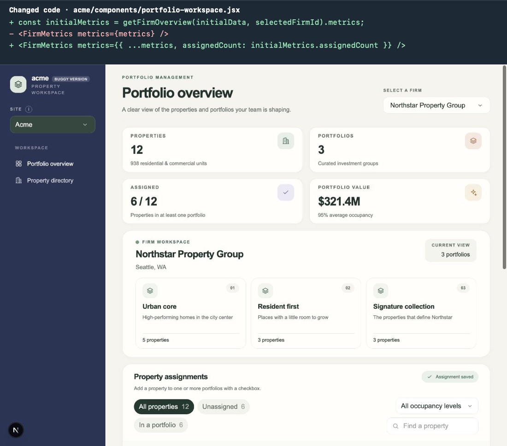

# Acme: five intentionally introduced defects

These are the five consecutive Acme defect commits following `56fb424`, in commit order. The examples use the Northstar sample data and the local Acme site. Each image pairs a rendered excerpt of the changed code with a screenshot of the affected site area. Minus and plus lines indicate the old and new code, respectively. The screenshots capture different test states; their counts should not be compared across images without the setup described below.

Run Acme with `npm run dev` from `acme`, then open `/acme`. Assignment changes save to the local runtime data. To reproduce from a clean sample, use `npm run data:reset` before loading the page; this removes the local runtime data, so preserve any changes you need first.

## 1. <a href="https://github.com/matt22/property-management/commit/4bf1d10e50f0151ddc761406683110c54907e14f" target="_blank" rel="noopener noreferrer"><code>4bf1d10</code></a> — portfolio cards overcount

**Change:** `components/workspace-sections.jsx` adds one to every portfolio's `propertyIds.length` when displaying its card. The underlying assignments do not gain a property.

**Reproduce:** With the sample data, Urban core contains four properties but its card says five. In the image, Beacon Hill Flats was temporarily assigned to Urban core: its actual five assignments are shown as six. The other two cards each say three even though each has two assignments.

## 2. <a href="https://github.com/matt22/property-management/commit/38509c4539040581a033cc626a3be2fdf9a73f4b" target="_blank" rel="noopener noreferrer"><code>38509c4</code></a> — 95% included in the wrong occupancy band

**Change:** `lib/property-filters.js` changes the upper bound for the 90% band from `< 95` to `<= 95`. A property at exactly 95% now matches both this band and the separate 95% to under 97% band.

**Reproduce:** Select **90% to under 95%**. Fremont Landing appears at 95%, despite the selected label excluding 95%.

## 3. <a href="https://github.com/matt22/property-management/commit/2284260bcb1bb902870dbb5a05833cd91871fdb1" target="_blank" rel="noopener noreferrer"><code>2284260</code></a> — assigned filter shows unassigned properties

**Change:** `components/property-assignment-matrix.jsx` translates the `assigned` selection to `unassigned` before calling `filterProperties`. Other selections pass through unchanged.

**Reproduce:** Select **In a portfolio**. The selected pill indicates six assigned properties, but the rows are the six properties marked **Not assigned**, with empty assignment checkboxes.

## 4. <a href="https://github.com/matt22/property-management/commit/b371f61bd54da2945b5677b459fb6ef523e0e9be" target="_blank" rel="noopener noreferrer"><code>b371f61</code></a> — table headers omit the final property

**Change:** `components/assignment-parts.jsx` removes the ID of the final property in the firm's `properties` array before counting each portfolio's members. A header is understated by one only when that final property belongs to the portfolio; otherwise it is unaffected. This is independent of which rows are filtered or visible.

**Reproduce:** Assign the last Northstar property, Beacon Hill Flats, to Urban core. Five Urban core checkboxes are checked, but its table header still says **4 properties**. In the screenshot, Beacon Hill Flats is checked at the bottom of the table. The separate card-count defect also affects the cards.

## 5. <a href="https://github.com/matt22/property-management/commit/d944277578c8e44a3387d7e13ac7234634110127" target="_blank" rel="noopener noreferrer"><code>d944277</code></a> — assigned summary uses initial data

**Change:** `components/portfolio-workspace.jsx` computes `initialMetrics` from `initialData` and overrides the live `metrics.assignedCount` passed to `FirmMetrics`. The assignment matrix uses the current client state, so the summary can lag it after a toggle until fresh server data arrives. A failed save can also expose a temporary discrepancy while optimistic state is rolled back.

**Reproduce:** Toggle a previously unassigned property and compare **Assigned** in the summary with **In a portfolio** in the assignment filters while the save is pending. In this local run, the server refreshed the initial data quickly after successful saves, so the screenshot shows the affected summary location rather than a persistent mismatch. During one observed removal the accessibility state briefly showed the old summary count of 8 while the filter showed 7.

